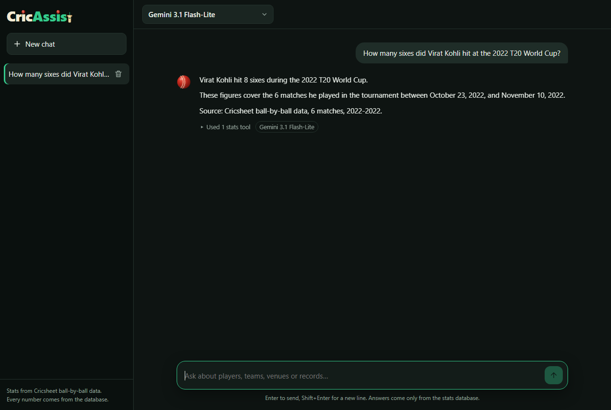
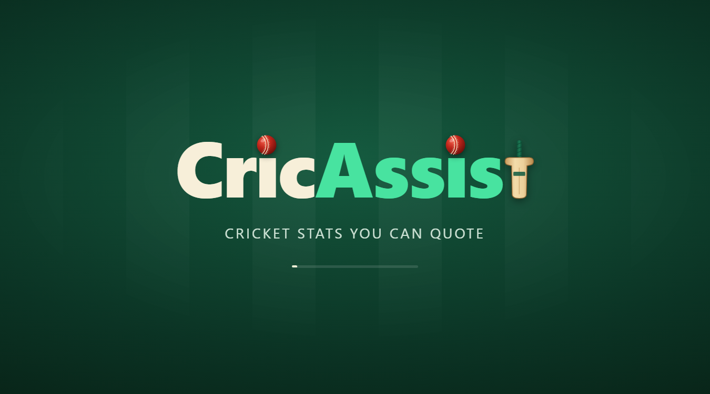
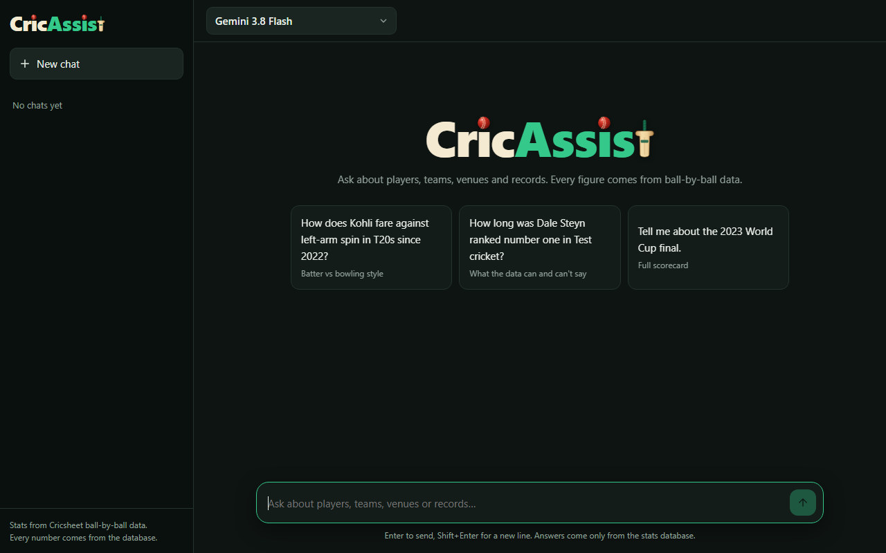
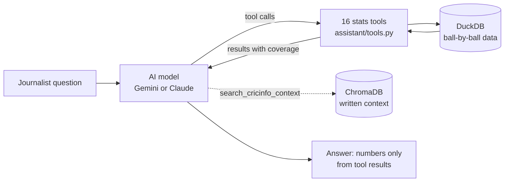

# CricAssist-Pro

An AI research assistant for cricket journalists. Ask a question in plain
English ("How does Kohli fare against left-arm spin in T20s since 2022?") and
get an answer whose every number comes from a ball-by-ball database of
14,585 matches, never from the AI model's memory.



| | |
|---|---|
| **Stats engine** | 5.85 million deliveries from Cricsheet (Tests, ODIs, T20Is since Dec 2001, plus 12 T20 leagues) in DuckDB, with queries for players, match-ups, teams, venues, phases, line and length, records and scorecards. |
| **Assistant** | Gemini (free tier) or Claude, calling 18 tools: 16 stats queries, a coverage lookup and a written-context search. Every figure in an answer must come from a tool result. When the data cannot answer, it says so. |
| **Accuracy** | 10 of 10 published stats match ESPNcricinfo. Evaluation: 14 of 15 questions correct, 15 of 15 with no unsourced numbers ([docs/evaluation.md](docs/evaluation.md)). |
| **Interfaces** | A local web app (streaming answers, chat sessions, model picker) and a command-line chat. |
| **Written context** | A complete scraping, embedding and retrieval pipeline (ChromaDB). It does not collect ESPNcricinfo pages, because the site's terms forbid it; see [ESPNcricinfo](#espncricinfo-and-written-context). |

## Requirements

| # | Requirement | Status |
|---|---|---|
| R1 | Statistical answers come from a structured database, never LLM memory or text parsing | Done. Enforced by the system prompt and measured by the evaluation's sourcing check. |
| R2 | Cricsheet ball-by-ball data | Done |
| R3 | Kaggle "The Ultimate Ball-by-Ball Cricket Dataset" | Done. Loaded into DuckDB with checksum, schema and row-count checks. |
| R4 | Rate-limited ESPNcricinfo scraper feeding a vector database | Pipeline built and tested. ESPNcricinfo's terms and bot protection prevent collecting its pages, so the live database is empty. |

## Quick start

Python 3.11 or newer.

**1. Install.** Takes a few minutes; ChromaDB has many dependencies.

Windows (PowerShell):

```powershell
python -m venv .venv
.venv\Scripts\Activate.ps1
pip install -e ".[dev]"
Copy-Item .env.example .env
```

macOS / Linux:

```bash
python -m venv .venv && source .venv/bin/activate
pip install -e ".[dev]"
cp .env.example .env
```

**2. Add an API key** to `.env`. The default is Gemini, which has a free tier:
create a key at [aistudio.google.com](https://aistudio.google.com) and set
`GEMINI_API_KEY`. For Claude, set `CRICASSIST_LLM_PROVIDER=claude` and
`ANTHROPIC_API_KEY`.

**3. Add the data.** Unzip the 18 CSVs of the Kaggle dataset into `data/raw/`
(about 2.4 GB; not in the repository), then build the database:

```bash
cricassist build-db
```

This checks each file's size, SHA-256 checksum and columns against
`src/cricassist/stats/dataset/manifest.json` and `schema.json`, loads them
into `data/processed/cricassist.db`, and checks row counts and keys. About a
minute. It rebuilds from scratch each time and only replaces the old database
once every check passes; stop the web app or chat first, as they keep the file
open. To check the files and database without rebuilding, run
`cricassist verify-db`.

**4. Ask questions.**

```bash
cricassist web     # web app at http://127.0.0.1:8000
cricassist chat    # or chat in the terminal
```

The tests need neither the dataset nor a key: `pytest` runs 163 tests on a
three-match sample in `tests/data/`.

## The web app

| Opening | Empty chat |
|---|---|
|  |  |

- Splash screen with the CricAssist logo: the i's are dotted with red leather
  balls and the final t is a bat.
- ChatGPT-style thread. While the assistant works, each stats tool it calls
  appears live, then the answer types itself out as the model writes it. Every
  answer can be expanded to list the tools behind it.
- Side panel of chat sessions. Chats answer independently: you can switch to
  another chat or ask elsewhere while one is still answering. A spinning ball
  marks a chat that is answering; a red dot marks a new answer you have not
  opened.
- Model picker (Gemini models; Claude when a key is set). Switching model
  mid-chat starts a fresh conversation with the new model.
- Chats are saved to `data/processed/chats.json` and come back when the server
  restarts, with their context, so follow-up questions still work.
- Runs on your computer only (`127.0.0.1`). Options: `--port`, `--no-browser`.

## Example questions

- How does Kohli fare against left-arm spin in T20s since 2022?
- How long was Dale Steyn ranked number one in Test cricket? *(The data has no
  rankings: the assistant says so instead of guessing, then shows his Test
  record by year.)*
- Tell me about the 2023 World Cup final. *(Full scorecard, every dismissal
  from the data.)*
- How has Shami been over the years in terms of consistency?
- Who were the best death-over bowlers in IPL 2025, and how does Bumrah compare?
- What's a par first-innings score at the Wankhede in the IPL?
- How many times has Josh Hazlewood dismissed Virat Kohli?

## How it works



1. **Data layer** (`stats/ingest.py`, `stats/db.py`). The CSVs are verified and
   loaded into DuckDB. Derived tables (`stats/views.py`) turn deliveries into
   batting and bowling innings, team innings, results, phases and dismissals,
   following ESPNcricinfo's scoring conventions: super overs excluded, wides
   are not balls faced, byes and leg byes are not charged to the bowler, run
   outs are not credited to the bowler, retired hurt is not out.
2. **Stats queries** (`stats/queries.py`). Players (career, form, by year,
   phases, line and length, against a bowler or bowling style), teams
   (head-to-heads, results, phases), venues, records, leaderboards and match
   scorecards. Every query takes filters for format, gender, competition,
   event, season, opposition, venue and dates. Renamed franchises count as one
   team (Delhi Daredevils is Delhi Capitals) and short names like CSK work
   (`stats/teams.py`). Every result reports how many matches it covers.
3. **Assistant** (`assistant/`). The model chooses tools and filters; the
   tools run against the database; the model writes the answer from the
   results. The system prompt (`assistant/prompts.py`) requires every number
   to come from a tool result: not from memory, not from its own sums or
   ratios across rows, not rounded. When the data cannot answer, it says so
   first and offers what the data can show.
4. **Interfaces.** The web app (`web/`: FastAPI with a plain HTML/CSS/JS page,
   answers streamed as Server-Sent Events) and the command line (`main.py`).

## Accuracy

**Known stats.** `python scripts/check_known_stats.py` compares 10 figures from
the full database with ESPNcricinfo's: Kohli's and Cook's Test careers,
Ashwin's best figures, Kohli's 973 runs in IPL 2016, the highest IPL and ODI
scores and totals, the lowest Test totals since 2001, and the 2023 World Cup
final. All 10 match.

**Evaluation.** `cricassist eval` asks 15 journalist questions with answers
verified against the database: 10 stats questions, 2 the data cannot answer,
2 needing written context, and 1 combined. Each answer is graded for the
expected facts and for sourcing: any number not found in the question, a tool
call or a tool result is reported, since it could only have come from the
model's memory or its own arithmetic. Latest run: **14 of 15 correct, 15 of 15
fully sourced**. Earlier runs caught the model inventing a match count,
computing ratios itself and recalling a dismissal wrongly; each led to a fix
([docs/evaluation.md](docs/evaluation.md)).

```bash
cricassist eval                        # all 15; resumes a run cut short
cricassist eval --model gemini-3.5-flash
cricassist eval --redo steyn_ranking   # run one question again
cricassist eval --summary              # print the last results
```

A full run takes about 45 model requests, more than one Gemini model's free
daily quota, so results are saved after each question.

## Data

| Source | Use | Licence |
|---|---|---|
| [Cricsheet](https://cricsheet.org) ball-by-ball data, via the Kaggle dataset "The Ultimate Ball-by-Ball Cricket Dataset" (snapshot 2026-10-10) | All stats | Open Data Commons Attribution License 1.0 |
| ESPNcricinfo ball tracking (line, length, shot), included in the Kaggle dataset | Line, length and shot breakdowns | As distributed with the dataset |

What the data covers: men's and women's Tests, ODIs and T20Is from December
2001, and the IPL, WPL, BBL, WBBL, PSL, CPL, BPL, LPL, SA20, ILT20, MLC and The
Hundred. Line and length tracking covers about half of matches since 2014.

What it does not cover, and the assistant says so when it matters:

- **Missing matches.** Cricsheet lacks some matches (about 160 men's Tests
  since 2001, mostly before 2009, and some ODIs and T20Is), so career totals
  can be lower than official records. Every result reports how many matches
  it is based on.
- **No Afghanistan internationals** at all, so every international against
  Afghanistan is missing too (for example, Bumrah has 12 of his 15 wickets
  from the 2024 T20 World Cup). Questions about Afghanistan get a clear
  explanation.
- No ICC rankings, matches before December 2001, or domestic first-class and
  List A cricket.

## ESPNcricinfo and written context

The assistant has a `search_cricinfo_context` tool for background the numbers
cannot give: what happened in a match, how a player plays. The pipeline behind
it is complete and tested:

1. A fetcher (`sources/cricinfo_client.py`) for the 34 matches and 100 players
   on `sources/scrape_list.json`. It reads robots.txt first, waits at least 3
   seconds between requests, identifies itself honestly, caches every page,
   and stops for the run when refused.
2. A parser (`sources/parsers.py`) and overlapping passages that keep their
   source URL, title and date (`context/passages.py`).
3. Local embeddings (all-MiniLM-L6-v2; no API key, about 80 MB downloaded on
   first use) in ChromaDB (`context/store.py`).

**Why the live database is empty.** ESPNcricinfo's terms of use (Disney terms,
section 2.B(x)) prohibit collecting its content "using a robot, spider, script,
or other automated means, including... for the purposes of creating or
developing any AI Tool, data mining or web scraping" without written
permission, and the site refuses automated requests, including robots.txt
(HTTP 403). The fetcher makes one request, is refused, and stops. It does not
disguise itself as a browser or work around the block, which is also why
`python-espncricinfo` (which bypasses the bot protection with a headless
browser) is not used. The assistant therefore tells users that no written
context is available and answers from the stats. Passages are background only:
the prompt forbids taking numbers from them.

Any text you have the right to use can be loaded without code changes:

```bash
cricassist build-context --local-only --source-dir path/to/documents   # .html, .txt, .md or .jsonl
```

## Commands

| Command | What it does |
|---|---|
| `cricassist build-db` | Verify the CSVs and build the stats database (`--skip-checksums`, `--raw-dir`) |
| `cricassist verify-db` | Check the CSVs and the built database without changing anything (`--skip-checksums`, `--files-only`, `--db-only`) |
| `cricassist web` | Open the web app (`--port`, `--no-browser`) |
| `cricassist chat ["question"]` | Chat in the terminal, or ask one question (`--model`, `--provider`, `--hide-tools`) |
| `cricassist eval` | Run the 15-question evaluation (`--model`, `--only`, `--redo`, `--summary`, `--fresh`) |
| `cricassist build-context` | Build the written-context database (`--no-fetch`, `--source-dir`, `--local-only`, `--delay`, `--reset`) |
| `python scripts/check_known_stats.py` | Compare 10 stats with ESPNcricinfo's figures |
| `pytest` | Run the tests (no dataset or key needed) |

## Configuration

Settings come from `.env` (see `.env.example`) or the environment.

| Variable | Default | Meaning |
|---|---|---|
| `CRICASSIST_LLM_PROVIDER` | `gemini` | `gemini` or `claude` |
| `CRICASSIST_LLM_MODEL` | `gemini-3.8-flash` / `claude-opus-5-5` | Model for the chosen provider |
| `GEMINI_API_KEY` / `ANTHROPIC_API_KEY` | | Key for the chosen provider |
| `CRICASSIST_DB_PATH` | `data/processed/cricassist.db` | Stats database |
| `CRICASSIST_CHATS_PATH` | `data/processed/chats.json` | Saved web chats |
| `CRICASSIST_CONTEXT_PATH` | `data/processed/context` | Written-context database |

**Gemini's free tier** allows a few requests per minute and a limited number
per model per day. The assistant waits out per-minute limits ("waiting 20s…");
when a model's daily quota is used up, pick another model. Each model has its
own quota.

## Project layout

```
src/cricassist/
  main.py               command line (cricassist ...)
  config.py             settings from .env
  stats/                data layer and stats queries
    dataset/            schema.json and manifest.json for the CSVs
    ingest.py, db.py    verified loading into DuckDB
    views.py            derived tables (innings, results, phases, dismissals)
    queries.py          the stats queries
    teams.py            renamed franchises and short team names
  assistant/            the AI assistant
    agent.py            conversation loop for Gemini and Claude
    tools.py            the 18 tools the model can call
    prompts.py          the system prompt (the rules for numbers)
  sources/              ESPNcricinfo fetcher, parser and scrape list
  context/              passages and the ChromaDB store
  evaluation/           the 15 questions and the grader
  web/                  web app server and page
scripts/                known-stats check, test-data and scrape-list builders
tests/                  163 tests on a three-match sample
docs/                   evaluation results and screenshots
data/raw/               the dataset CSVs (not committed)
data/processed/         built databases, saved chats, eval results (not committed)
```

## Troubleshooting

| Problem | Fix |
|---|---|
| `'cricassist' is not recognized` | Activate the virtual environment, or run `python -m cricassist.main ...` |
| `No database at data/processed/cricassist.db` | Run `cricassist build-db` |
| `GEMINI_API_KEY is not set` | Put the key in `.env` (not `.env.example`) |
| `free daily quota ... is used up` | Choose another model in the web app, or use `--model` |
| Install fails with a long-path error on Windows | Clone into a short path such as `C:\code\CricAssist-Pro`, or enable Windows long paths |
| PowerShell will not run `Activate.ps1` | Run `Set-ExecutionPolicy -Scope CurrentUser RemoteSigned` once |

## Acknowledgements

Ball-by-ball data from [Cricsheet](https://cricsheet.org), used under the Open
Data Commons Attribution License 1.0, via the Kaggle dataset "The Ultimate
Ball-by-Ball Cricket Dataset".
